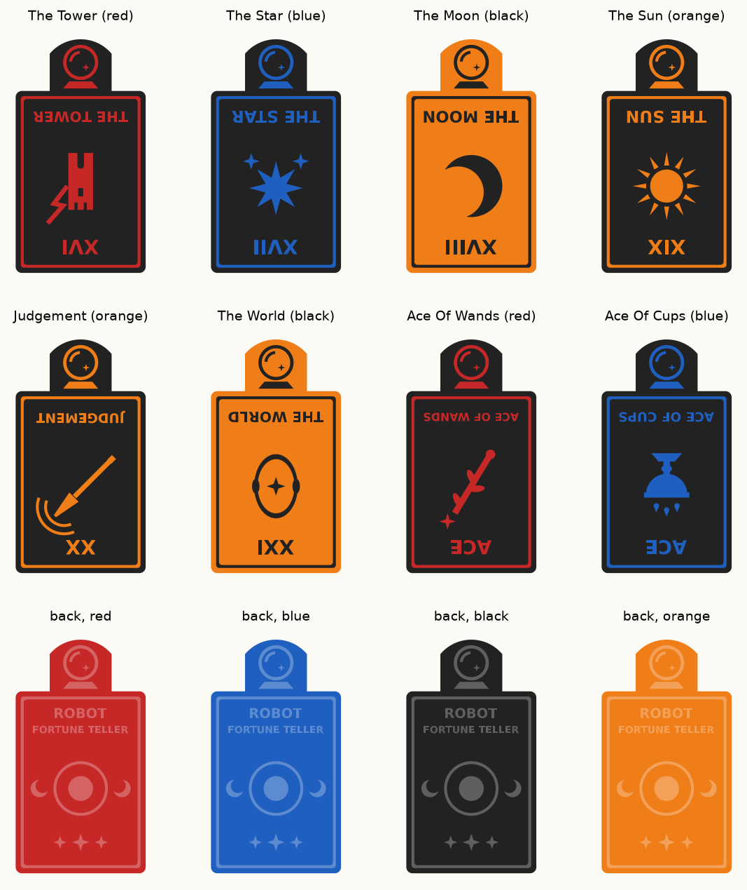

# Cards and props

Everything the arm touches: the fortune deck, the deck tray and the reveal stand. All parts are code-generated
(Python, manifold3d + trimesh), checked automatically, and print in PLA with no supports.



## The deck (v3): print these

| Card | Tarot | Upright meaning | Print in | First 0.6 mm (face) | File |
|---|---|---|---|---|---|
| The Tower | XVI | sudden upheaval, broken pride | **red** | black | `out/deck/card_16_tower.3mf` |
| Ace of Wands | Ace | inspiration, new opportunities, growth | **red** | black | `out/deck/card_101_ace_of_wands.3mf` |
| The Star | XVII | hope, faith, rejuvenation | **blue** | black | `out/deck/card_17_star.3mf` |
| Ace of Cups | Ace | love, new feelings, compassion | **blue** | black | `out/deck/card_102_ace_of_cups.3mf` |
| The Sun | XIX | joy, success, celebration, positivity | **orange** | black | `out/deck/card_19_sun.3mf` |
| Judgement | XX | reflection, reckoning, awakening | **orange** | black | `out/deck/card_20_judgement.3mf` |
| The Moon | XVIII | the unconscious, illusions, intuition | **black** | orange | `out/deck/card_18_moon.3mf` |
| The World | XXI | completion, integration, accomplishment | **black** | orange | `out/deck/card_21_world.3mf` |

Eight cards, two per filament colour, paired by meaning (wands = fire = red, cups = water = blue). The agent's
deck (`agent/cards.py`) lists the same eight.

- **Back: the same design on every card**, in the card's colour: "ROBOT / FORTUNE TELLER", a sun-and-moon emblem,
  three stars and a border, raised 0.6 mm. The grip handle stands out of this side. The colours mean the backs
  are not identical from above, but they let a camera tell which card was drawn.
- **Face: one per card.** Numeral, one simple symbol and the name, engraved 0.6 mm. **Turned 180°**: the arm
  flips the card end over end to show it (handle ends up at the bottom), so the face reads upright for the guest
  only after that flip and looks upside down with the handle up. `FACE_ROTATED = False` in `generate_deck.py`
  undoes it (e.g. if the card goes in the reveal stand handle-up). See `out/flip_before_after.png`.
- **Handle: v2's block shape, smooth, with a low dome and a crystal ball.** The 30 × 18 × 14 mm block keeps its
  two flat grip faces 14 mm apart (the shape base Dream-1 picked up on Nov 7), but **without v2's friction ribs**.
  A 7 mm low dome replaces the flat top, and a 17 mm crystal ball outline is engraved 0.6 mm on both faces,
  covering the dome. About 80% of each grip face stays flat (`check_deck.py` reports it). Card 63 × 113 × 14 mm.
  **Untested on the arm:** smooth faces have less friction; `GRIP_RIBS=1` brings the ribs back (with a smaller ball).
- **No tag sticker:** the backs are truly identical. (`TAG_POCKET = True` in `generate_deck.py` adds a
  27 × 27 mm pocket for an ArUco sticker, if the harness needs to read the card by tag again.)

### Printing

- **Face down** on the bed, as exported (the engraved face is on the bed, the handle points up). No supports.
- PLA, 0.2 mm layers, 15 to 20% infill, 3 walls. About 7 to 10 g per card.
- **Colours:** print each card in its colour (table above) and **swap filament at 0.6 mm** (after layer 3, the
  face skin) as listed: the face then shows the symbol, name and crystal ball in the card's colour on a black
  face (orange face for the black Moon card).
- Matte filament if you have it: shiny PLA confuses the depth cameras.

### Rebuild

```bash
cd cards
python3 -m venv .venv && .venv/bin/pip install trimesh manifold3d numpy shapely matplotlib
.venv/bin/python generate_deck.py                 # all eight; or --only 16,101
.venv/bin/python check_deck.py                    # needs out/card_v2.stl as the handle reference
.venv/bin/python make_print.py                    # out/print: single cards, 4 colour plates, fortune_deck_print.zip
```

Add a card: add it to `DECK` and `COLORS`, draw its symbol in `symbol()` in `generate_deck.py` (keep strokes at least
1.4 mm wide), then rebuild and check. Also add it to `agent/cards.py` so the Fortune Teller can read it.

## Deck tray and reveal stand (v2)

| Part | What | File |
|---|---|---|
| Deck tray | Cards lean back 15°; the front card's handle is always in the same spot | `out/deck_tray.3mf` |
| Reveal stand | 40 mm funnel into a 6 mm slot; the card ends up at 60° facing the guest | `out/reveal_stand.3mf` |

Spec: `SPEC_V2.md`. Rebuild: `.venv/bin/python generate_v2.py && .venv/bin/python check_v2.py` (also writes
`out/card_v2.stl`, the handle reference). `generate_card.py` and `check_card.py` are card v1, kept because the
v2 scripts import their helpers.

## History

`CARD_PROCESS.md` tells how the card was designed, printed and tested (v1 → v2 → this deck). `SPEC.md` is the v1
spec with the gripper facts every version is built on.
